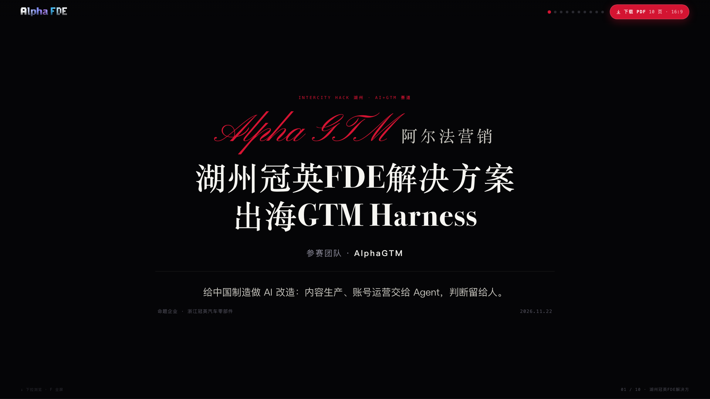
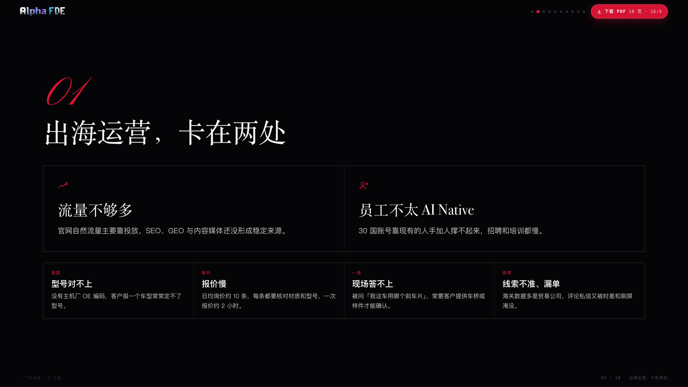
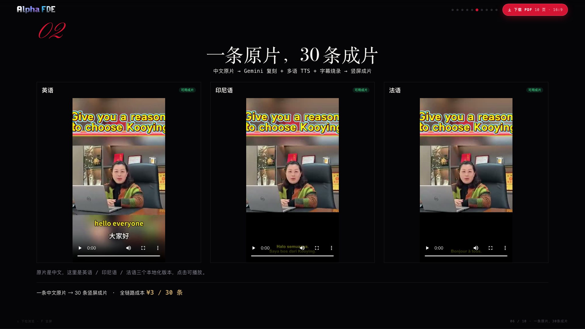
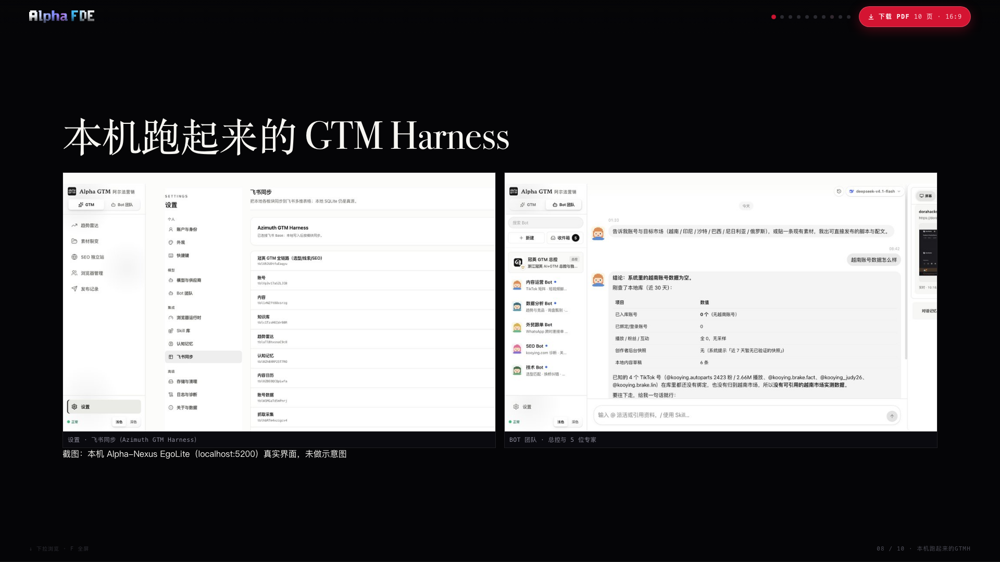
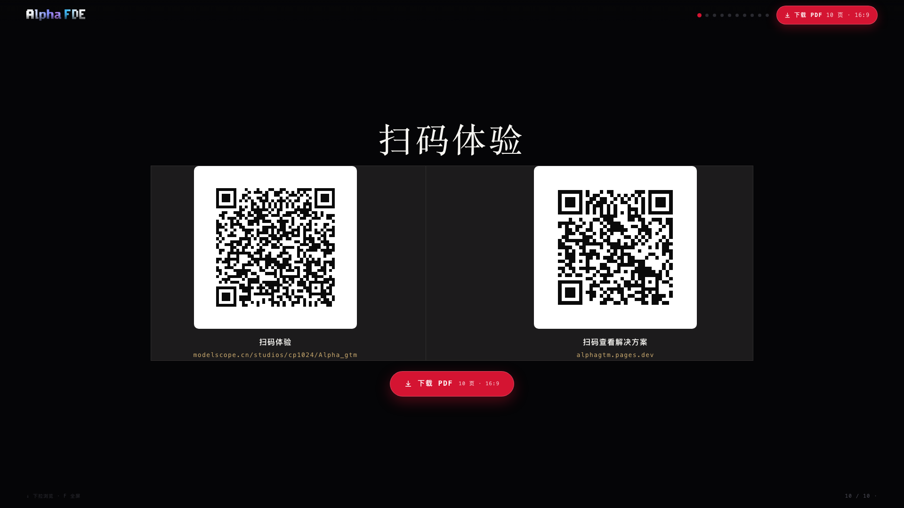

# 湖州冠英FDE解决方案 + 出海GTM Harness

> AlphaGTM · INTERCITY HACK 湖州场 · AI+GTM 赛道 · 命题企业：浙江冠英

一个人，运营 30 国账号。

内容生产、账号运营交给 AI；型号、客户、报价这些要判断的事，还是人来做。

---

## 冠英卡在哪

浙江冠英做商用车刹车片，一年产 1500 万套，卖到 30 多个国家。有产品、有客户，就是数据没串起来。

- 一天十来条询价，每条翻材质、核型号，报一次价要 2 小时
- 客户在汽配店问「我这车用哪片刹车片」，销售当场答不上，得让人拍车桥、寄样件
- 不是主机厂配套厂，没有 OE 编码；车桥换过一次就锁不住型号，同款在不同厂家编码还不一样
- 海关数据搜出来一屏贸易公司，社媒线索不准，评论私信被时差和刷屏冲掉
- 一个 2423 粉、266 万播放的老号 2023 年停更了，302 条工厂实拍还留在国内

---

## 我们做了五件事

1. **数据打通** — 产品、客户、内容接成一套，人和 AI 用同一份数据
2. **趋势雷达** — 看平台在热什么，哪条内容带来了线索
3. **素材裂变** — 一条中文原片，做成 30 条本地语言成片，字幕烧好直接发
4. **账号统一管** — 国内外平台账号、权限、发布节奏放在一处
5. **SEO 优化** — 按型号建页，让客户搜得到，带来自然流量

一条线索进来，最后落到「这个车型用哪个型号、报价依据是什么」。

---

## 一条原片，30 条成片

中文原片进去，出来英语、印尼语、法语……30 条竖屏成片。30 条全链路成本 **¥3**。

---

## 真机界面

产品已经在本机跑起来：飞书数据同步、BOT 团队、趋势雷达、账号管理。

---

## 看完整方案

- **10 页路演**：<https://alphagtm.pages.dev/>
- **在线体验**：<https://modelscope.cn/studios/cp1024/Alpha_gtm>
- **PPT / PDF**：见 [`show/deck/`](show/deck/)

